# Niceone Obsidian

<p align="center">
  
</p>

<h2 align="center">AI Systems Architect · Software Developer · Automation Engineer</h2>

<p align="center">
  Building governed AI systems, reliable agent workflows, and evidence-driven software.
  <br>
  <strong>Think → Verify → Authorize → Execute → Validate → Learn</strong>
</p>

<p align="center">
  <a href="https://github.com/niceoneobsidian/niceone-obsidian">Flagship: OIS</a> ·
  <a href="https://github.com/niceoneobsidian/universal-social-intelligence">USIE</a> ·
  <a href="https://github.com/niceoneobsidian/niceone-engineering-governance">Engineering Governance</a>
</p>

---

## Profile

My work focuses on the architecture and implementation of AI execution systems: agent orchestration, policy boundaries, durable state, verification, recovery, knowledge and memory, social intelligence, and engineering governance.

The central design rule is simple: **a model's output is a proposal, not permission or proof of success.** Systems should authorize consequential actions, verify outcomes independently, preserve evidence, and recover safely from failure.

## Current Project Portfolio

| Project | Purpose | Current status |
|---|---|---|
| **[OIS — Obsidian Intelligence System](https://github.com/niceoneobsidian/niceone-obsidian)** | Governed AI execution platform spanning cognition, planning, capabilities, agents, tools, policy, runtime, validation, recovery, evidence, and learning. | **Core platform in active engineering.** Repository documentation defines architecture and evidence-based maturity gates; production readiness must be established through implementation and runtime evidence, not design alone. |
| **[Universal Social Intelligence Engine (USIE)](https://github.com/niceoneobsidian/universal-social-intelligence)** | Evidence-first collection and capture pipeline for social/web URLs, with provenance and explicit collection statuses. | **P0 complete; P1 extraction foundations in progress.** The generic metadata adapter reads saved DOM evidence; it is not a platform-specific extractor and the project is not production-certified. |
| **[Niceone Engineering Governance (NUEGS)](https://github.com/niceoneobsidian/niceone-engineering-governance)** | Versioned engineering governance specification, control registry, repository profiles, validation tooling, and adoption guidance. | **Initial proposed baseline.** Includes 20 engineering domains and profiles for OIS and AI agents. No repository is presumed compliant without evidence. |
| **Obsidian Project Intelligence (OPI)** | Project/task management and execution-intelligence layer that delegates governed execution to OIS and orchestration to Agent Weave. | **Application pilot / integration work.** Package, focused tests, integration contract, packaging metadata, and CI have been extracted. Durable runtime wiring, end-to-end validation, deployment, and operational readiness remain open milestones. |
| **Niceone Agent Weave** | Local-first agent orchestration that checks changes independently, enforces command policy, records evidence, and supports file-based project memory. | **Phased implementation.** Published project documentation describes verification/evidence, policy and bounded recovery, and file-based memory. Isolation and research/event capabilities remain planned there. |
| **Niceone Command** | Command-line interface and developer workflow tooling for the Niceone ecosystem. | **Active development.** See the repository for current implementation and verification status. |
| **Niceone CLI** | Additional command-line tooling. | **Private repository / in development.** Details are intentionally not represented as public release claims. |

> **Status discipline:** Project summaries reflect repository documentation available at the time this profile was updated. They are not a substitute for the latest CI results, open issues, runtime checks, or release evidence.

## System Architecture

The Niceone ecosystem separates responsibilities rather than building one monolith:

- **OIS — governance and execution:** policy, authorization, durable execution, validation, recovery, and evidence.
- **Agent Weave — agent orchestration:** delegates coding work and checks whether the result satisfies independent verification criteria.
- **OPI — project intelligence:** task lifecycle, plans, operator workflow, and cross-system reporting.
- **USIE — social/web evidence ingestion:** captures source evidence and records collection outcomes before downstream interpretation.
- **NUEGS — engineering governance:** defines reusable controls, profiles, and verification expectations across repositories.

```text
OBJECTIVE
   ↓
PROJECT INTELLIGENCE / PLANNING
   ↓
POLICY + AUTHORIZATION (OIS)
   ↓
CAPABILITY / AGENT / TOOL ROUTING
   ↓
EXECUTION
   ↓
INDEPENDENT VALIDATION
   ↓
STATE + EVIDENCE + OBSERVABILITY
   ↓
MEASUREMENT → LEARNING → CONTROLLED CHANGE
```

## Engineering Principles

- Reasoning does not grant authority.
- Architecture does not prove implementation.
- A successful command is not automatically a successful outcome.
- Missing required checks are not passes.
- Evidence must preserve provenance and uncertainty.
- Retries must be bounded; recovery must avoid unsafe repetition.
- Credentials and sensitive local state stay out of source control.
- Production changes must be observable, versioned, and reversible.
- Learning may propose changes; governance controls promotion.

## Technical Focus

**Languages and automation:** Python, TypeScript, JavaScript, Bash  
**AI systems:** local models, agent orchestration, model routing, structured outputs, memory and retrieval  
**Backend and state:** SQL, PostgreSQL-oriented execution state, SQLite, durable workflows, idempotency  
**Quality and security:** unit/integration testing, linting, type checking, policy gates, secret hygiene, evidence-based acceptance  
**Developer infrastructure:** Git, GitHub, GitHub Actions, Linux, macOS, terminal-first workflows  
**Knowledge and design:** Obsidian, Notion, system architecture, capability contracts, governance specifications  
**Intelligence systems:** social/web collection, metadata extraction, provenance, content intelligence, analytics and feedback loops

*This is a working technology focus, not a claim of equal production expertise in every tool.*

## Current Engineering Priorities

1. **Prove OIS runtime readiness** with test, persistence, authorization, recovery, migration, security, and deployment evidence.
2. **Keep project boundaries explicit** across OIS, OPI, Agent Weave, and USIE; integrate through stable contracts.
3. **Strengthen evidence-first ingestion** in USIE while preserving honest status semantics for blocked, partial, unavailable, and failed captures.
4. **Apply engineering governance** through machine-checkable registries, repository profiles, tests, and CI—not documentation alone.
5. **Improve local-first AI development** while controlling resource use, costs, and permissions.
6. **Build measurable feedback loops** so system changes are evaluated against observed outcomes.

## Explore the Work

- [OIS source repository](https://github.com/niceoneobsidian/niceone-obsidian)
- [USIE source repository](https://github.com/niceoneobsidian/universal-social-intelligence)
- [Engineering governance specification](https://github.com/niceoneobsidian/niceone-engineering-governance)
- [All public repositories](https://github.com/niceoneobsidian?tab=repositories)
- [GitHub profile and activity](https://github.com/niceoneobsidian)

## Connect

- [X](https://x.com/NiceoneObsidian)
- [LinkedIn](https://www.linkedin.com/in/niceone-obsidian-4515b842a/)
- [DEV Community](https://dev.to/niceoneobsidian)
- [Medium](https://medium.com/@niceoneobsidian)
- [Email](mailto:niceoneobsidian@gmail.com)

---

<p align="center">
  <sub>Build deliberately. Verify independently. Preserve evidence. Improve from results.</sub>
</p>
